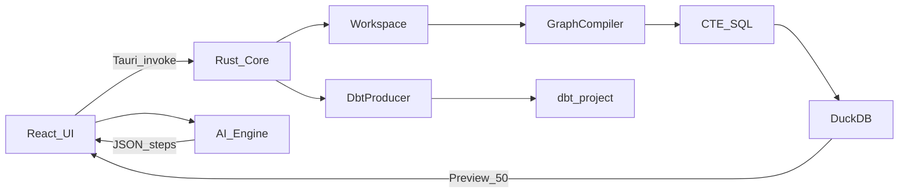

# DWH-RS-QUERY — Architecture

## 1. System context

## 2. Invariants

1. Rust does not hold the full row dataset — only the Workspace AST + ephemeral preview ≤50 rows.  
2. Heavy lifting is DuckDB.  
3. **Canonical model is Workspace (multi-query)**; a single query is a special case.  
4. One compile path: Workspace → SQL CTEs **and** Workspace → dbt models.  
5. Raw table data never goes to an LLM.

ADRs: [0001](adr/0001-product-positioning.md) … [0008](adr/0008-postgres-required.md) (see `docs/adr/`).

**IR rule (H0):** Workspace AST is the only source of truth; DuckDB SQL and dbt files are projections. Two-way parse-back is H1/H2, not a v1 DoD.

## 3. Modules

| Path | Role |
|------|------|
| `crates/dwh-pipeline` | `TransformationStep`, `Workspace`, `GraphCompiler` |
| `crates/dwh-pipeline/producers` | `OutputProducer`, `DbtProducer` |
| `crates/dwh-engine` | DuckDB session, preview |
| `src-tauri` | IPC commands |
| `src/` | Queries UI, History, Preview, Export |

## 4. Compile flow

1. Resolve query dependency order (Join/Append edges).  
2. For each query in topo order: emit CTEs `q_<id>_s<i>`.  
3. Final: `SELECT * FROM q_<focus>_sLAST [LIMIT 50]`.

dbt: Load* → `stg_` (+ `sources.yml`); intermediate Join/transforms → `int_`; focus last → `mart_`.

## 5. Threat model

Local-trust; quote paths/idents; never log connection strings; never send preview rows to an LLM.

## 6. Extensions

- **`postgres`:** required capability. Eager `INSTALL/LOAD` at session start when possible. If load fails, CSV/Parquet may still run; any workspace using `LoadPostgres` must fail with a clear error ([ADR-0008](adr/0008-postgres-required.md)).  
- **`spatial`:** optional sidecar file only (`extensions/spatial.duckdb_extension`); never bare `LOAD` / `~/.duckdb`; must not block CSV/Postgres paths.

## 7. Language & licensing note

Canonical documentation is **English** (possible future OSS; decision pending).
