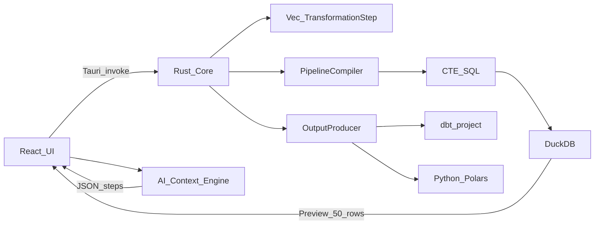

# DWH-RS-QUERY — Architecture

## 1. System context

Локальный процесс Tauri: WebView (React) ↔ IPC ↔ Rust. DuckDB живёт в Rust-процессе. LLM (если настроен) вызывается с машины пользователя; в промпт уходят только метаданные схемы и шаги.

## 2. Invariants

1. **Rust не хранит row data пайплайна.** В памяти ядра — `Vec<TransformationStep>` и эфемерный preview result set (≤50 строк) для ответа IPC.
2. **Тяжёлая работа — в DuckDB** (out-of-core, spill хэш-таблиц при `GROUP BY`).
3. **Один compiler path:** шаги → единый CTE SQL (`WITH step_0 AS (...), ... SELECT * FROM step_N [LIMIT 50]`).
4. **Producers не трогают runtime DuckDB** — только генерация артефактов из того же AST.
5. **Сырые данные не уходят в облако** как часть продукта; AI получает schema + steps + prompt.

## 3. Backend modules (`src-tauri/src/`)

| Path | Responsibility |
|------|----------------|
| `pipeline/model.rs` | `TransformationStep` enum (serde tagged) |
| `pipeline/compiler.rs` | AST → CTE SQL |
| `pipeline/validate.rs` | prefix compile + `LIMIT 0` / DESCRIBE walk для DnD |
| `pipeline/sql_escape.rs` | quoting путей и идентификаторов |
| `db/session.rs` | in-memory DuckDB; `INSTALL/LOAD postgres`, `spatial` |
| `commands/` | Tauri commands (см. SPEC) |
| `producers/mod.rs` | trait `OutputProducer` |
| `producers/dbt.rs` | dbt project (stg_ / mart_) |
| `producers/python.rs` | Polars method-chaining script |

## 4. Frontend modules (`src/`)

| Path | Responsibility |
|------|----------------|
| `types/pipeline.ts` | wire types, зеркало Rust enum |
| `store/pipelineStore` | steps, schema, preview, errors |
| `components/History` | DnD список шагов |
| `components/PreviewTable` | TanStack Table + `@tanstack/react-virtual` |
| `components/AiChat` | NL → invoke / parse JSON steps |
| `lib/tauri.ts` | typed `invoke` wrappers |
| `lib/debounce.ts` | 150ms preview debounce |

## 5. Data flow

### 5.1 Preview

1. UI меняет `steps` (или параметры шага)
2. Debounce 150ms (где применимо)
3. `preview_pipeline(steps)` → compiler `to_sql(is_preview=true)` → DuckDB
4. Ответ: колонки + ≤50 строк (+ опционально скомпилированный SQL для debug)

### 5.2 DnD validate

1. UI считает кандидата `steps'`
2. `validate_reorder` / `describe_pipeline` по префиксам
3. Ok → commit в store; Err → UI откат + сообщение DuckDB

### 5.3 Export

1. UI выбирает producer + `output_dir` + `pipeline_name`
2. Rust `OutputProducer::produce` пишет файлы
3. Runtime DuckDB не вызывается (кроме опциональной pre-validate)

## 6. Threat model (local-trust)

Приложение — single-user local tool. Пользователь может ввести произвольный SQL в Filter / Derive / CustomSql — это ожидаемо.

Обязательные меры:

- Пути файлов в `LoadCsv` / `LoadParquet` проходят через quoting helper (экранирование `'`)
- Identifiers в Rename/Select — quote при необходимости
- Connection strings Postgres **не логировать** в stdout/файлы приложения
- AI transport: не включать preview rows / file contents в запрос к LLM

## 7. Extension loading

При старте `db/session.rs`:

1. Открыть in-memory DuckDB
2. `INSTALL postgres; LOAD postgres;`
3. `INSTALL spatial; LOAD spatial;`
4. Ошибка load → fatal startup error (DoD #1)

Spatial в MVP только для успешного load; шагов geo в AST нет.

## 8. Related docs

- Продукт / UX: [DESIGN.md](DESIGN.md)
- Контракты и DoD: [SPEC.md](SPEC.md)
- Исходный ТЗ: [TZ-EARLY.md](TZ-EARLY.md)
